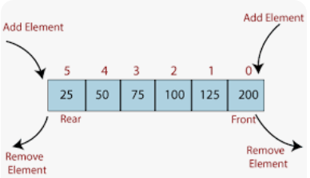

# Conteúdo

Tipo: Página

**Pilha e suas operações empilha (push) e desempilha (pop):**

**Fila e suas operações enfileira e desenfileira:**

**Nas deques o acesso é sempre pelas extremidades:**

Se a **deque** for de acesso **geral** , pode-se inserir nas duas extremidades e retirar das duas extremidades, apenas é necessário informar em qual ou de qual extremidade.   

Se for uma **deque de entrada restrita** , a inserção é por apenas uma das extremidades, já pré-definida, e a remoção é pelas duas (nesse caso é necessário definir em qual).

Se for uma **deque de saída restrita** , a remoção é por uma extremidade já pré-definida, enquanto que a inserção pode ser pelas duas (nesse caso é necessário definir em qual).

[Arquivo: Slides](arquivos/pilhas-filas-deques-slides.pdf)

**Pilhas, filas e deques, e aplicações:**

[Arquivo: Aplicação de pilha](arquivos/pilhasfilasdeques.pdf)
