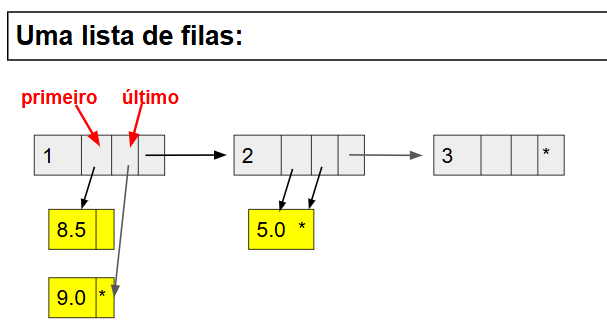

# Conteúdo

Tipo: Página

**Matriz Esparsa e suas representações: uma aplicação para explorar alternativas de implementação usando listas**

**\- O que é uma matriz esparsa?**

Uma matriz é dita **esparsa** quando possui uma grande quantidade de elementos ou que valem zero, ou não estão presentes, ou não são necessários. Assim, opta-se por armazenar essas matrizes através de outras estruturas que ocupem apenas o espaço necessário, mas mantendo as informações relevantes: o valor armazenado, e as posições de linha e coluna correspondentes.

Matrizes esparsas têm aplicações em problemas de engenharia, física (por exemplo, o método das malhas para resolução de circuitos elétricos ou sistemas de equações lineares). Também têm aplicação em computação: armazenamento de dados (e.g., planilhas eletrônicas)

**Implementação de matrizes esparsas: listas de listas**

A matriz esparsa pode ser implementada através de um conjunto de listas: ou um conjunto de vetores, ou um conjunto de listas encadeadas, de forma que os elementos que possuem valor não significativo não sejam armazenados.

Exemplo:

**matriz original (4X5):**

0 | 0 | 0 | 3 | 0  
---|---|---|---|---  
0 | 2 | 0 | 0 | 0  
7 | 0 | 0 | 0 | 4  
0 | 0 | 0 | 0 | 0  

Poderia ser representada por 3 vetores: um para armazenar os valores significativos, outro para as linhas correspondentes, e outro para as colunas correspondentes:

**Valores** :

3 | 2 | 7 | 4  
---|---|---|---  

**Linhas **: 

0 | 1 | 2 | 2  
---|---|---|---  

**Colunas** :

3 | 1 | 0 | 4  
---|---|---|---  

* * *

**Multilistas**

Listas de listas, listas de filas, pilhas de listas, etc

**Exemplo** :

[Arquivo: Multilistas - slides](arquivos/multilistas.pdf)
