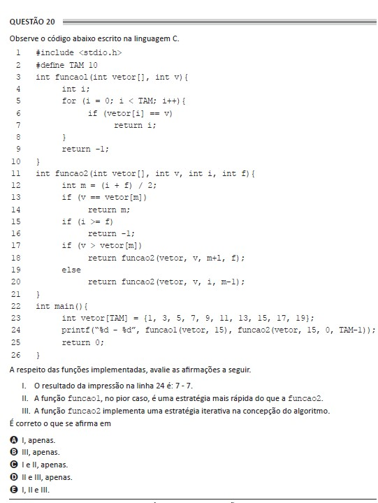

# Exercício

Tipo: Página

**Pesquisa em listas:** questão do ENADE 2021:

**Tabelas hash:**

Considere a seguinte sequência de elementos (n): 8-3-5-10-12-18-11-20-2-1-30-40-22-15

a) Sendo H(n) a função resto(n,7), para inserções em uma tabela de  _hash_ de 7 posições:  
0  
1  
...  
6  
Insira os elementos em uma estrutura baseada em  _hashing_ aberto, com ordenação das listas por  
ordem de entrada.

b) Insira os elementos em uma estrutura baseada em  _hashing_ fechado com  _bucket_ , com 3  _buckets_ , no qual cada  _bucket_ tem 5 posições (_overflow_ de 4 posições).

c) Insira os elementos em uma estrutura baseada em  _hashing_ fechado com busca linear de posição, para uma função de reespalhamento RH = resto (H(n) + 1, tamanhoTabela), e para a qual o tamanho da tabela é igual a 17.
