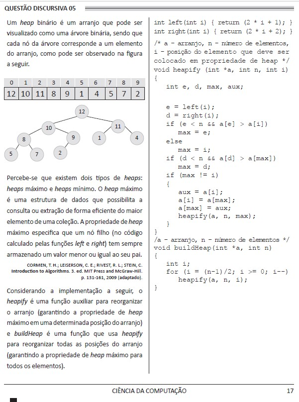
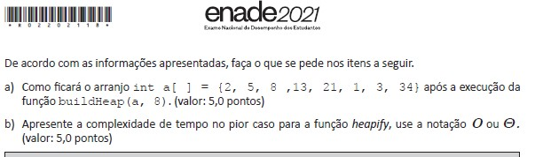

# Heap e Heapsort

Tipo: Página

**Aula de 23/10:**

Em ciência da computação , um heap é uma estrutura de dados baseada em árvore (hierarquia) que satisfaz a propriedade de heap: Em um heap máximo , para qualquer nó F1 dado, se P for um nó pai de F1, então a chave (o valor) de P é maior ou igual à chave de F1. Em um heap mínimo , a chave de P é menor ou igual à chave de F1.

O heap é uma implementação eficiente de um tipo de dado abstrato chamado de fila de prioridade. Filas de prioridade são frequentemente chamadas de "heaps", independentemente de como podem ser implementadas:  
\- Em um heap, o elemento de maior (ou menor) prioridade é sempre armazenado na raiz.   
\- No entanto, um heap não é uma estrutura classificada, ele pode ser considerado como sendo parcialmente ordenado. 

Um heap é uma estrutura de dados útil quando é necessário remover repetidamente o objeto com a maior (ou menor) prioridade, ou quando inserções precisam ser intercaladas com remoções do nó raiz.

Uma implementação comum de um heap é o heap binário , no qual a árvore é uma árvore binária que pode ser representada por um vetor. A estrutura de dados do heap, especificamente o heap binário, foi introduzida por JWJ Williams em 1964, como uma estrutura de dados para o algoritmo de classificação heapsort .

Mais informações: 

<https://pt.wikipedia.org/wiki/Heap>

<https://www.geeksforgeeks.org/dsa/heap-data-structure/>

**Questão do ENADE sobre heap:**

